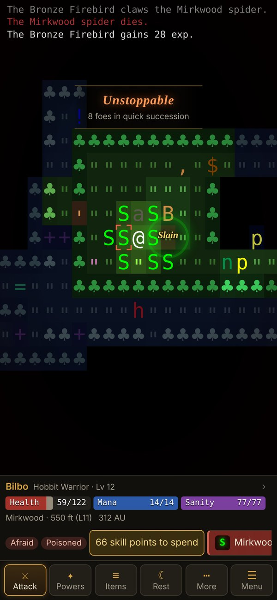
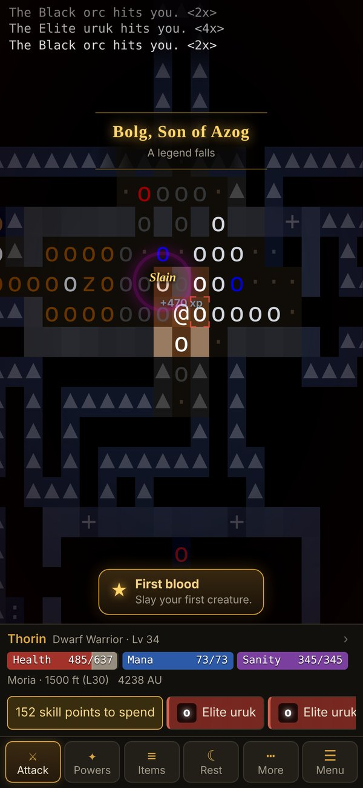
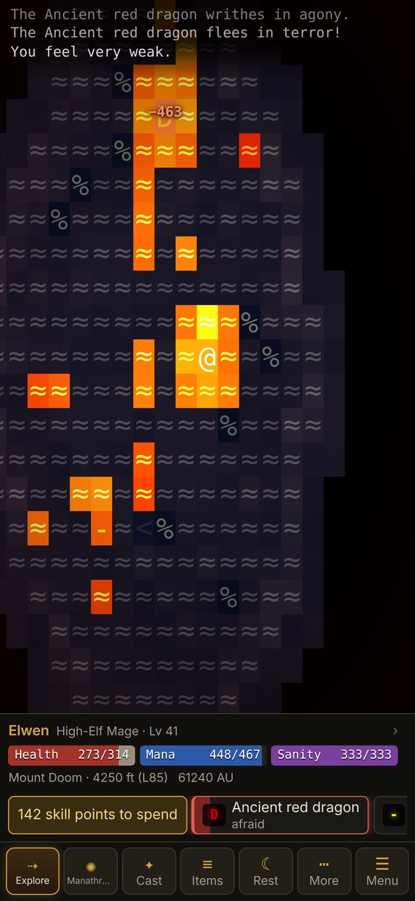

  

<h1 align="center">ToME — Tales of Middle-earth</h1>

  <strong>A classic roguelike adventure through Tolkien's Middle-earth, rebuilt for your phone.</strong>

  

---

## The adventure

Leave the comfort of Bree and walk out into a wide, dangerous Middle-earth. Explore the wilderness, visit the great towns, and descend into dungeons that grow deadlier with every level: the dark woods of **Mirkwood**, the **Barrow-downs**, the endless halls of **Moria**, the fires of **Mount Doom**. Somewhere far below waits **Sauron** — and deeper still, in **Angband**, the first Dark Lord himself, **Morgoth**.

Every level is generated fresh, every hero is different, and death is permanent. That is what makes each victory count.

- **22 races** — Hobbits, Dwarves, Ents, Beornings, Maiar, High-Elves and more, with optional twists such as Vampire or Spectre.
- **30 classes** — from Warrior and Ranger to Necromancer, Geomancer, Possessor, Symbiant and Bard.
- **A free-form skill system** — spend points where you like and shape your hero your way.
- **Gods to follow** — pledge yourself to Eru, Manwë, Tulkas, Varda, Ulmo… or Melkor.
- **Nearly 900 creatures** and **almost 200 legendary artifacts** to find, wield and lose.
- **Quests, towns and shops** across the whole of Middle-earth.

<table>
  <tr>
    <td width="33%"></td>
    <td width="33%"></td>
    <td width="33%"></td>
  </tr>
  <tr>
    <td align="center"><b>Choose your hero</b> from 22 races and 30 classes</td>
    <td align="center"><b>Gather legendary gear</b> and tap anything to read about it</td>
    <td align="center"><b>Music composed live</b> for every place you go</td>
  </tr>
  <tr>
    <td width="33%"></td>
    <td width="33%"></td>
    <td width="33%"></td>
  </tr>
  <tr>
    <td align="center"><b>Mirkwood</b> · a Hobbit at level 12 cuts through a spider nest</td>
    <td align="center"><b>Moria</b> · a Dwarf at level 34 fells Bolg amid an orc army</td>
    <td align="center"><b>Mount Doom</b> · a High-Elf mage at level 41 puts a dragon to flight</td>
  </tr>
</table>

## Made for touch

This is the full ToME 2 game, with an interface designed from scratch for phones and tablets.

| | |
|---|---|
| **Tap** | Walk to any place you have seen — doors open on the way. A tap into the dark takes one step towards it. Tap a creature beside you to fight it. |
| **Press and hold** | Look at anything on the map: *"a Village idiot (awake, unhurt) on grass"*. |
| **Drag** · **Pinch** | Look around the level without moving · zoom in and out. |
| **Explore** | One button maps the level for you, room by room, picking up gold, walking past your companions and stopping the moment danger appears; once the level is done it heads for the stairs. |
| **Toolbar** | One button changes with the moment — *Attack*, *Pick up*, *Descend*, *Enter shop*, *Eat* when hungry, *Light* in the dark, else *Explore* — and your own buttons (your quick spell, Cast, Fire, Items, Rest) stay where they are. |

**Everything is a tap away.** Your pack, equipment, character sheet, skills, abilities and knowledge are proper mobile screens, not text menus. Tap any item to read about it and use it; tap your name for your character; tap a creature for what you know about it. Questions — *how many?*, *which direction?*, *which target?* — appear as simple cards.

**Shops and your home.** Browse a shop's whole stock in one list, tap anything to inspect it, then buy as many as you can afford. Sell from the same screen: each shop says what it buys and what it will pay. Store your treasures at home and take them back whenever you like.

**A dungeon that glows.** Torchlight flickers and fades into darkness, lava casts a molten glow, water shimmers, and spells light up the walls as they fly. Places you've seen linger in a dim, blue memory.

**Fights you can feel.** Damage numbers float off wounded foes, the fallen leave a ring in their colour, heavy blows shake the screen, and banners mark a new level, a deeper descent, a kill streak or a legend slain.

**A legend of your own.** Earn deeds as you play — *First blood*, *Giant-slayer*, *Into the deep* — and when a hero falls, read their tale: creatures slain, the mightiest foe, the deepest point reached, and a tip for next time. The **Hall of Fame** on the title screen remembers every fallen hero, your career and the deeds still to earn.

**Music for every place.** The soundtrack is composed live as you play, so it is never quite the same twice. Its leitmotifs — the hero's horn call, the Bree jig, the Dwarf march, the Shadow's theme — are recast for each place you visit and swell when danger is near, while sound effects bring every swing, door and spell to life. Hear every theme from **Soundtrack** on the title screen.

**Your way.** Portrait or landscape, phone, tablet or desktop. Four text sizes, adjustable animation, separate music and sound volumes, classic ASCII symbols if you prefer them, dungeon levels that stay as you left them (or are new each visit), and full keyboard support with all the original ToME keys. Settings also reminds you of the rules you chose for each adventure.

## New to roguelikes?

- **Take it slowly.** Nothing moves until you do — the game is turn-based, so there is always time to think.
- **Read before you fight.** Press and hold a creature to see how dangerous it is.
- **Use Explore and Rest.** Let the game do the walking, and rest to recover before going deeper.
- **Open Help** from the game menu (☰) or the title screen any time: a searchable guide to the controls, the dungeons, every race and class, and much more.

## Your adventures

- The game **saves automatically** when you leave the app, and **☰ → Save and quit** returns you to the title screen.
- The title screen offers **Continue** for your last hero, with their level, class and where they stand. **More adventurers** lists the rest; tap any hero to play on, or to delete them.
- **☰ → Abandon adventure** ends the current adventure for good. Your other heroes, the Hall of Fame and your deeds stay.
- Everything lives in your browser on this device. **Backup** on the title screen exports all of it as one file, to keep it safe or move it to another device, and imports it again.
- Clearing your browser's site data deletes your adventures, so export a backup first.

## Install it on your device

The game runs in any modern browser. Add it to your home screen and it becomes a web app: full screen, and playable offline once it has loaded.

- **iPhone and iPad:** open the [game](https://darrencroton.github.io/tales-of-middle-earth/) in Safari, tap **Share**, then **Add to Home Screen**.
- **Android:** open it in Chrome, tap **⋮**, then **Install app** (or **Add to Home screen**).
- **Desktop:** in Chrome or Edge, click the install icon in the address bar.

New versions install themselves while you're on the title screen, never in the middle of a game.

---

## Heritage and credits

ToME stands on the shoulders of one of gaming's oldest family trees. It descends from **Moria** (Robert Alan Koeneke, 1983) and **Angband** (Alex Cutler and Andy Astrand, 1990), and began life as **PernAngband** before **DarkGod** (Nicolas Casalini) reshaped it into **Tales of Middle-earth**. DarkGod and a large community of contributors built the game you play here; see their [credits](https://github.com/tome2/tome2/blob/master/doc/credits.txt). The game engine is the open-source [tome2/tome2](https://github.com/tome2/tome2), unchanged, running in your browser.

The lighting and look are inspired by [Brogue: Community Edition](https://github.com/tmewett/BrogueCE); no Brogue code or assets are used. And above all, thanks to J.R.R. Tolkien, for the world.

ToME is distributed free for educational, research and not-for-profit purposes; see [LICENSE](LICENSE).
