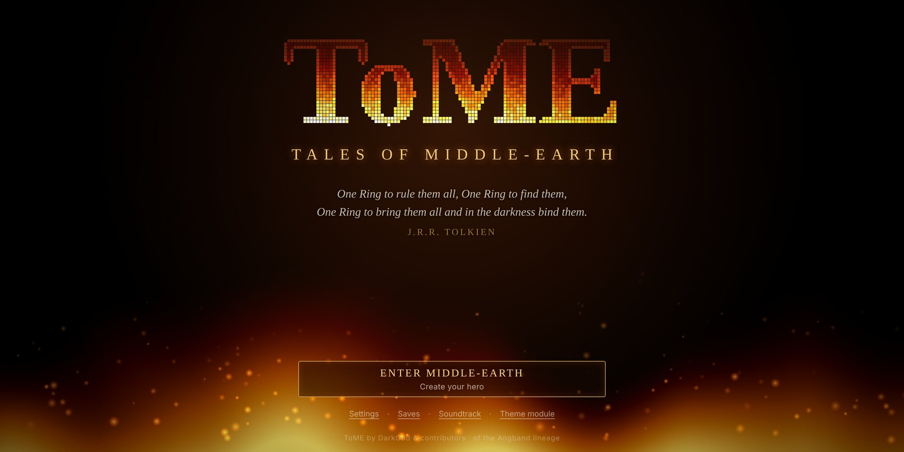
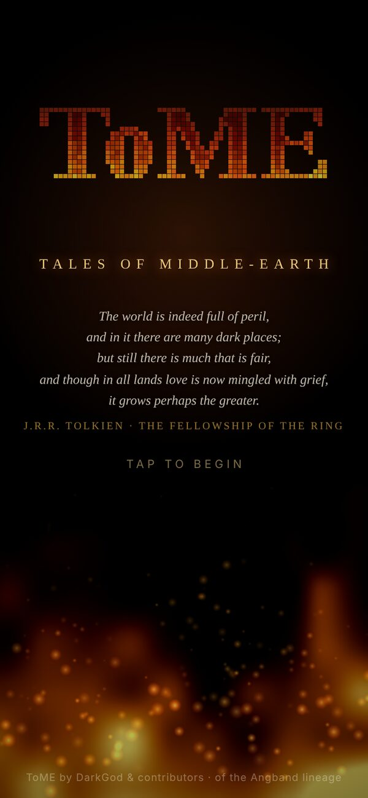
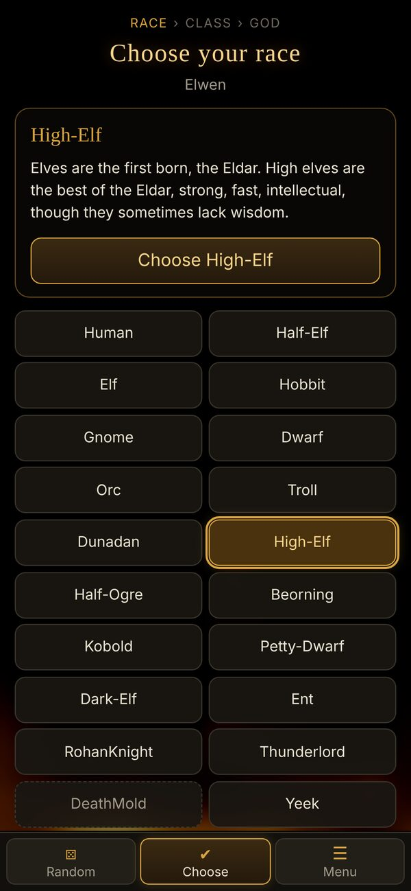
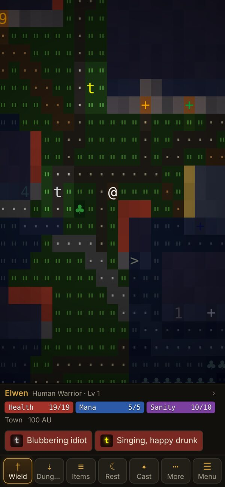
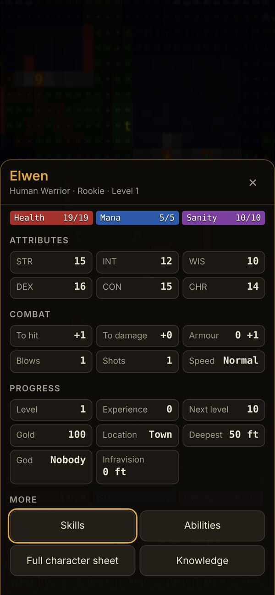
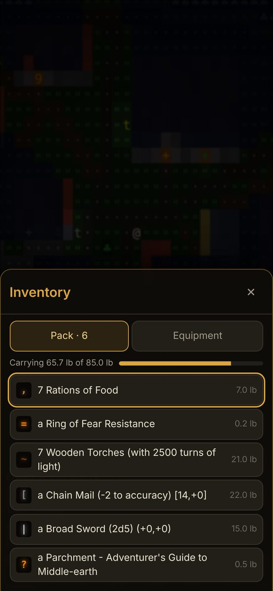
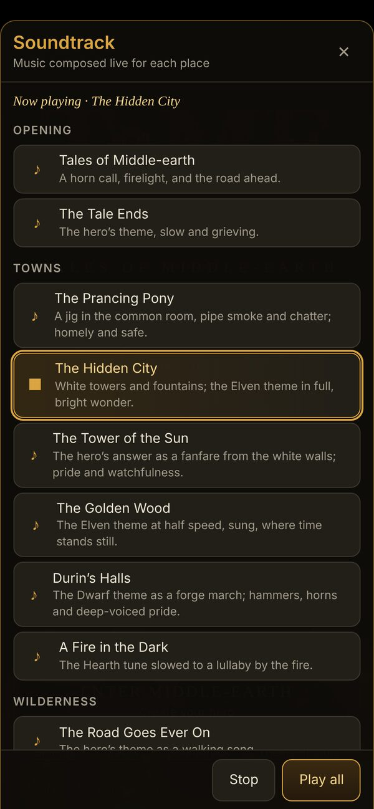

  

<h1 align="center">ToME — Tales of Middle-earth</h1>

  <strong>A classic roguelike adventure through Tolkien's Middle-earth, rebuilt for your phone.</strong>

  

---

## The adventure

Leave the comfort of Bree and walk out into a wide, dangerous Middle-earth. Explore the wilderness, visit the great towns, and descend into dungeons that grow deadlier with every level: the dark woods of **Mirkwood**, the **Barrow-downs**, the endless halls of **Moria**, the fires of **Mount Doom**. Somewhere far below waits **Sauron** — and deeper still, in **Angband**, the first Dark Lord himself, **Morgoth**.

Every level is generated fresh, every hero is different, and death is permanent. That is what makes each victory count.

- **22 races** — Hobbits, Dwarves, Ents, Beornings, Maiar, High-Elves and more, with optional twists such as Vampire or Spectre.
- **Around 30 classes** — from Warrior and Ranger to Necromancer, Geomancer, Possessor, Symbiant and Bard.
- **A free-form skill system** — spend points where you like and shape your hero your way.
- **Gods to follow** — pledge yourself to Eru, Manwë, Tulkas, Varda, Ulmo… or Melkor.
- **Nearly 900 creatures** and **almost 200 legendary artifacts** to find, wield and lose.
- **Quests, towns and shops** across the whole of Middle-earth.

Prefer a world closer to the books? Choose **Theme module** on the title screen for an alternative take on Middle-earth.

<table>
  <tr>
    <td width="33%"></td>
    <td width="33%"></td>
    <td width="33%"></td>
  </tr>
  <tr>
    <td width="33%"></td>
    <td width="33%"></td>
    <td width="33%"></td>
  </tr>
</table>

## Made for touch

This is the full ToME 2 game, with an interface designed from scratch for phones and tablets.

| | |
|---|---|
| **Tap** | Walk to any place you can see — doors open on the way. Tap a creature beside you to fight it. |
| **Press and hold** | Look at anything on the map: *"a Village idiot (awake, unhurt) on grass"*. |
| **Drag** · **Pinch** | Look around the level without moving · zoom in and out. |
| **Explore** | One button walks you to the next unexplored room or item, stops when danger appears, and heads for the stairs once the level is done. |
| **Smart toolbar** | Shows what makes sense right now — *Attack*, *Pick up*, *Descend*, *Heal* when you're badly hurt, *Eat* when hungry, *Light* in the dark. |

**Everything is a tap away.** Your pack, equipment, character sheet, skills, abilities and knowledge are proper mobile screens, not text menus. Tap any item to read about it and use it; tap your name for your character; tap a creature for what you know about it. Questions — *how many?*, *which direction?*, *which target?* — appear as simple cards.

**A dungeon that glows.** Torchlight flickers and fades into darkness, lava casts a molten glow, water shimmers, and spells light up the walls as they fly. Places you've seen linger in a dim, blue memory.

**Fights you can feel.** Damage numbers float off wounded foes, the screen flashes red when you're hit, and banners celebrate a new level or a deeper descent.

**Music for every place.** The soundtrack is composed live on your device as you play, so it is never quite the same twice. It is built from a handful of leitmotifs that follow you through the story: the hero's horn call opens the game, becomes a walking song on the road and a fanfare in Minas Anor; the Bree jig slows to a fireside lullaby in a safe haven and turns sly and minor for thieves; the Dwarf march rings out in Khazad-dûm and falls to slow drums in the deep of Moria; the Shadow's theme marches in Mordor, whispers in Dol Guldur and blazes at Mount Doom. When you move on, the music finishes its phrase and turns into the new key through a pivot chord rather than stopping dead. It swells when danger is near and muffles to a heartbeat when you are badly hurt, and sound effects bring every swing, creaking door, clinking coin and spell to life. Every theme can be heard from **Soundtrack** on the title screen.

**Your way.** Portrait or landscape, phone, tablet or desktop. Four text sizes, adjustable animation, separate music and sound volumes, classic ASCII symbols if you prefer them, and full keyboard support with all the original ToME keys.

## New to roguelikes?

- **Take it slowly.** Nothing moves until you do — the game is turn-based, so there is always time to think.
- **Read before you fight.** Press and hold a creature to see how dangerous it is.
- **Use Explore and Rest.** Let the game do the walking, and rest to recover before going deeper.
- **Check *How to play*** in the game menu (☰) any time for a quick guide to the controls.

## Your saves

- The game **saves automatically** when you leave the app, and **☰ → Save and quit** returns you to the title screen.
- Saves live in your browser on this device. Use **Export saves** (in the ☰ menu or on the title screen) to keep a backup or move your hero to another device, and **Import saves** to bring it back.
- Clearing your browser's site data deletes your saves, so export a backup first.

## Install it on your device

The game runs in any modern browser. Add it to your home screen and it becomes a web app: full screen, and playable offline once it has loaded.

- **iPhone and iPad:** open the [game](https://darrencroton.github.io/tome2mobile/) in Safari, tap **Share**, then **Add to Home Screen**.
- **Android:** open it in Chrome, tap **⋮**, then **Install app** (or **Add to Home screen**).
- **Desktop:** in Chrome or Edge, click the install icon in the address bar.

New versions install themselves while you're on the title screen, never in the middle of a game.

---

## Heritage and credits

ToME stands on the shoulders of one of gaming's oldest family trees. It descends from **Moria** (Robert Alan Koeneke, 1983) and **Angband** (Alex Cutler and Andy Astrand, 1990), and began life as **PernAngband** before **DarkGod** (Nicolas Casalini) reshaped it into **Tales of Middle-earth**. DarkGod and a large community of contributors built the game you play here; see their [credits](https://github.com/tome2/tome2/blob/master/doc/credits.txt). The game engine is the open-source [tome2/tome2](https://github.com/tome2/tome2), unchanged, running in your browser.

The lighting and look are inspired by [Brogue: Community Edition](https://github.com/tmewett/BrogueCE); no Brogue code or assets are used. And above all, thanks to J.R.R. Tolkien, for the world.

ToME is distributed free for educational, research and not-for-profit purposes; see [LICENSE](LICENSE).
